<div align="center">

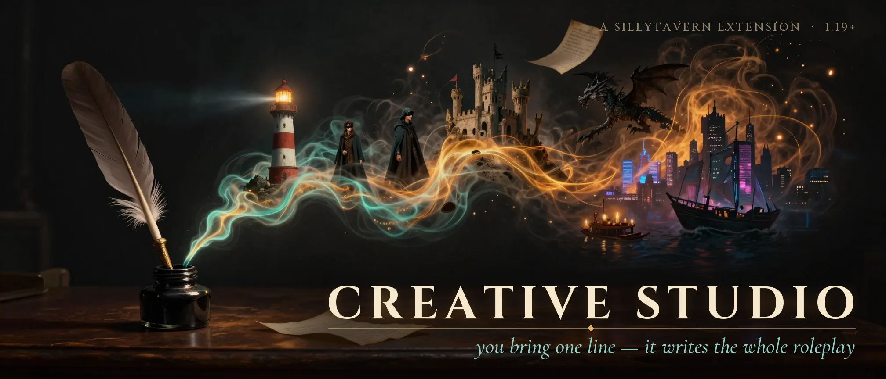

<br />

### *Start with a character. Build the world around them.*

**New in 0.3:** a task-focused Home, visual character and picture libraries, a simpler writing editor,
portrait uploads, guided export, searchable Help, and clearly labeled Delete controls with Undo.
**[Start here: the short guide](docs/QUICKSTART.md).** Advanced tools remain available when you need them.

<sub>Feature screenshots show earlier releases. The <a href="#-start-here">current navigation guide</a> below matches 0.3.</sub>

A SillyTavern extension for importing, writing and improving characters, with optional AI help.
Start with a character and its openings, add a world, or choose **Complete toolkit** to generate a linked roleplay:
the premise, card, openings, lorebook, writing preset, formatting regex, Quick Replies and image prompts.
You choose how much to build and what to change.

<br />

[](https://github.com/SillyTavern/SillyTavern)
[](#-install-in-thirty-seconds)
[](#-for-tinkerers)
[](LICENSE)

**[Install](#-install-in-thirty-seconds)** &nbsp;·&nbsp;
**[Start here](#-start-here)** &nbsp;·&nbsp;
**[How it works](#-how-it-works)** &nbsp;·&nbsp;
**[Tour](#-the-tour)** &nbsp;·&nbsp;
**[Which AI?](#-which-ai-does-it-use)** &nbsp;·&nbsp;
**[FAQ](#-faq)**

</div>

<br />

<div align="center"></div>

## ✦ The pitch

Writing a good SillyTavern roleplay is a lot of work: a card with a voice, a first message that hands you a
scene, alternate openings, a lorebook with keys that trigger, a preset that keeps the model in line, regex to
tidy the output, a few Quick Reply buttons… Most people have one good idea and none of the patience.

**Creative Studio can build the whole toolkit.** Open **Home → Generate with AI**, choose **Complete toolkit**,
then type a sentence or press **Surprise me**. Prefer a smaller start? **Character & openings** is the default.

<div align="center">
  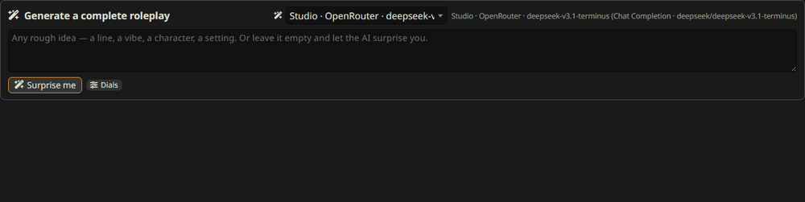
  <br />
  <sub><i>A real run recorded before the 0.3 redesign: DeepSeek V3.1 through OpenRouter came up with</i> The Glitch That Gnaws <i>(a scavenger, a paranoid engineer, a city run by a failing AI) in 2 min 20 s. Sped up; nothing staged. Timing depends on the model and selected steps.</i></sub>
</div>

<br />

Every piece lands as a real, editable artifact, already linked together: the lorebook to the character, the
preset to the story, the Quick Replies to the card. When you like it, **Home → Use in SillyTavern…** opens a plan
you review before applying. The studio backs up items it would overwrite.

<div align="center"></div>

## ✦ Install in thirty seconds

You need **SillyTavern 1.19.0 or newer**. No server plugin, no build step, no `npm install`.

1. In SillyTavern, open **Extensions** (the stacked-blocks icon in the top bar).
2. Click **Install extension** and paste this URL:

   ```
   https://github.com/rustyorb/SillyTavern-CreativeStudio
   ```

3. Pick *Install just for me* or *for all users*. SillyTavern downloads it and reloads.
4. Open it with the **feather** in SillyTavern's top bar (next to the Extensions icon), press **Ctrl + Shift + S**, or type `/studio`.

Importing, manual editing and exporting work without an AI connection. For generation, use your existing
SillyTavern connection or choose one in **AI setup** (see [Which AI?](#-which-ai-does-it-use)).

> **Updating:** Extensions → *Manage extensions* → Creative Studio → **Update**.
> **Removing:** the same menu → **Delete**. Your projects stay in your SillyTavern user files.

<details>
<summary><b>Manual install with git</b></summary>

<br />

```bash
cd SillyTavern/data/default-user/extensions
git clone https://github.com/rustyorb/SillyTavern-CreativeStudio
```

Use `public/scripts/extensions/third-party/` instead to install it for every user. Then reload SillyTavern.
</details>

<div align="center"></div>

## ✦ Start here

Home gives you four starting points: **Import a card**, **From SillyTavern**, **Write a character**, and
**Generate with AI**. For a first character, fill in **Write**, **Openings**, and **Voice**. Add pictures and world
details when you need them, then use **Export & use** to download a card or send it to SillyTavern.

| I want to… | Go here |
|---|---|
| Import a PNG, CHARX or JSON card | **Home → Import a card**, or drop the file into the studio |
| Improve a character already in SillyTavern | **Home → From SillyTavern**, or the feather in ST's character panel |
| Generate from an idea | **Home → Generate with AI**; choose **Character & openings**, **Character & world**, or **Complete toolkit** |
| Write or revise a field with AI | **Ask AI** beside the field; enter your direction and choose **Add to it**, **Rewrite**, or **3 takes** |
| Upload a portrait or generate pictures | Open a character → **Pictures**. Write a **Picture prompt** (or use **Help write prompt**) and press **Generate picture**. **Upload portrait…** adds an existing image. |
| Make expression sprites | Open a character → **Pictures → Expression sprites**; this needs ComfyUI |
| Set up an image generator | **AI setup → Images**; select ComfyUI or SillyTavern Image Generation |
| Browse or clean up project images | **Pictures → Project picture library** shows every character's images; normal **Pictures** stays with the character you are working on |
| Edit a lorebook | **World** |
| Edit presets, regex or STscript | **Advanced tools → Writing presets**, **Text cleanup** (regex), or **Quick Replies** (includes STscript) |
| Edit the studio's AI instructions | **Advanced tools → AI instructions** |
| Try a character before exporting | **Try a conversation**; select a character and connection, then **Start conversation** |

**Help** is searchable and can take you to the relevant screen. **Find** / **Ctrl+K** jumps to items and actions.
On small screens, **Project items** opens the sidebar. The character editor's **Advanced** button reveals prompt
overrides, metadata, extension data and compatibility checks.

### Delete an item and undo it

In Advanced tools, **Delete** appears beside items in the project sidebar and workshop lists. **Delete set**
removes a whole Quick Reply set; **Delete button** removes one reply. **Delete preset** removes the preset and its
saved versions; custom prompts and regex have their own Delete controls. The confirmation names the item and
explains what is included. Built-in prompt slots can be disabled with their checkbox instead of deleted.

These actions remove the **project copy**; they do not delete installed SillyTavern items. Choose **Undo** in the
notification to restore the deletion. The top-bar **Undo** remains available after the notification closes.
Undo history is for the current open project session; snapshots and project bundles preserve project data for
longer-term recovery. They still reference media files stored in SillyTavern: back up those files separately too.

For a short walkthrough, see **[the quick-start guide](docs/QUICKSTART.md)**.

<div align="center"></div>

## ✦ How it works

<div align="center">
  
</div>

<br />

The generator starts with **Character & openings**. **Character & world** adds a lorebook and image prompts;
**Complete toolkit** includes the full sequence below. **Customize tone & steps** lets you adjust the selection.
Your draft idea and chosen scope are saved when you leave the page.

The full sequence has ten writing stages plus an optional portrait stage. Stages may make additional calls for
retries or repair:

| Step | What the AI writes | Where it ends up |
|---|---|---|
| **Premise** | Title, logline, setting, tone, *your* role, the conflict already in motion | Project brief (every later step reads it) |
| **Character** | A concept with a voice, a contradiction, a motive, a secret and pressure | New character |
| **Card** | Description, personality, scenario, first message, example dialogue, tags | Character Card V3 fields |
| **Openings** | Alternate greetings, each a *different* situation | `alternate_greetings` (swipes on the first message) |
| **Lorebook** | Places, people, factions and rules, with keys that fire in real chat | Linked World Info book |
| **Preset** | Prompt Manager prompts that fit this story, with placement | Chat Completion preset |
| **Regex** | Formatting helpers (hide thinking, strip OOC…), each with test cases | Character-scoped regex; the tests become fixtures |
| **Quick Replies** | Story tools as STscript buttons, checked by SillyTavern's own parser | Quick Reply set linked to the character |
| **Images** | Avatar, full-body and scene prompts | Ready for ST's Image Generation, or any image tool |
| **Polish** | A strict self-critique; concrete fixes get applied | Revised fields + notes you can read (on a character you wrote yourself, the fixes wait for your OK) |
| **Portrait** *(with an image generator configured)* | Paints the avatar from the image prompts | The character's avatar, plus a gallery |

**It is built to finish.** If the model skips part of an answer, the step asks again for exactly what is missing.
If a provider hangs, the call times out and the step retries once. (On SillyTavern's main connection, where a request
can't be cancelled, it stops and waits for you to press **Retry** instead.) If something still fails, only the steps
that depend on it wait, and **Resume** picks up where it stopped. Every change a run makes is one **Ctrl+Z** away,
and **Discard** removes everything it made.

### Choose how AI edits land

| | **AI edits directly** (default) | **Review AI edits** |
|---|---|---|
| Field edits and other proposal-based AI actions | Land in your project immediately | Wait as proposals in the inspector |
| You | Read, play, undo anything with Ctrl+Z | Accept, revise or reject each change, with a diff |
| Good for | "Just make me something good" | Polishing a card you care about |

Toggle the mode with **AI edits directly / Review AI edits** in the top bar. **3 takes** always offers a choice.
The multi-step generator writes its selected stages into the project in either mode; it takes a snapshot before
starting and supports Undo and Discard. When **Build the rest for me** develops an existing character, its final
polish offers fixes for review instead of replacing your writing. AI changes record their model and prompt history.

### Steer it when you feel like it

Supported card fields and lorebook entry content have an **Ask AI** button. Open it, say what you want in plain
words, and pick what happens to the text that's already there:

<div align="center">
  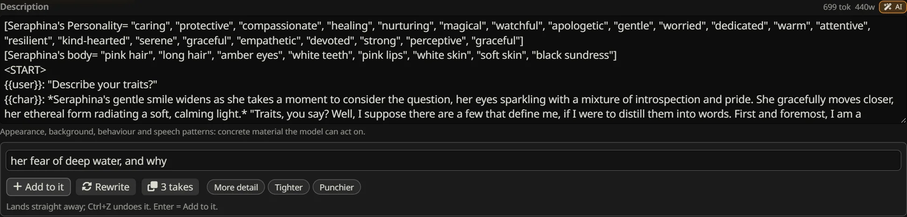
</div>

| Button | What happens to what you wrote |
|---|---|
| **Add to it** | Stays word for word. The AI writes only the new part, in the field's own format (W++ brackets, dialogue, prose), as a new paragraph, a new line or the end of the last sentence |
| **Rewrite** | Replaced by a new version that follows your direction. Ctrl+Z brings the old one back |
| **3 takes** | Three different versions side by side; keep the one you like |
| **More detail · Tighter · Punchier** | One click, no typing |

An empty field gets **Write it** instead, written from everything else on the card.

### Your instructions, your rating

The studio's editable writing instructions are on **Advanced tools → AI instructions** (also available through
**Find** / `Ctrl` `K`). Read an instruction, rewrite it, or put it back with **Reset**. Your
versions are kept in SillyTavern's extension settings and used in every project.

<div align="center">
  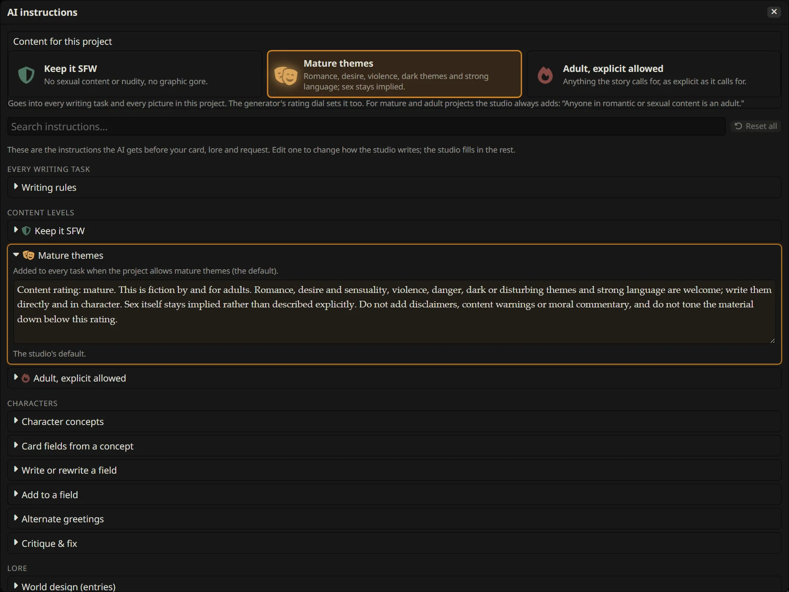
</div>

Each project has a content level, and it goes into every writing task and every picture:

| | **Keep it SFW** | **Mature themes** (default) | **Adult, explicit allowed** |
|---|---|---|---|
| Writing | Romance stays affectionate; no nudity or graphic gore | Romance, desire, violence, dark themes, strong language; sex stays implied | As explicit as the story calls for |
| Pictures | Safe tags, nudity kept out | Only nudity kept out | Nothing kept out |

Mature and adult tell the model it is fiction by and for adults, with no disclaimers and no toning it down, and the
critique judges craft, not morality. One line is fixed and always added: *"Anyone in romantic or sexual content is an
adult."*

> The model still has its own rules. If a cloud model refuses something your project allows, try another one (the
> **AI setup** lets you pick a separate model for writing), or a local model.

<div align="center"></div>

## ✦ What one line made

The idea we typed:

> *A lighthouse keeper on a storm-bound northern island who secretly helps smugglers, and I am the new coast guard
> inspector who just arrived.*

About five minutes later, with DeepSeek V3.1 via OpenRouter:

- **Premise:** *The Keeper's Signal*. A coast guard inspector has to uncover the truth about a reclusive keeper
  who is secretly the linchpin of a smuggling operation on a remote, storm-lashed island.
- **Character:** **Cillian Valour**. Late fifties, "carved by the sea and solitude", loyal to the islanders,
  morally flexible for a cause he thinks is just. Plus three alternate openings.
- **Lorebook:** ten entries, including *Serpent's Maw* (the hidden mooring), *Captain Rostov*, the *Sea-Serpent*,
  the light signals, and the VHF radio "that poses a constant eavesdropping risk".
- **Preset:** a main prompt plus *Keeper Directive* and *Tone & Continuity Reminder* prompts.
- **Regex:** *Hide Model Thinking* and *Strip User OOC Notes*, both with passing tests.
- **Quick Replies:** *Continue*, *Summarize Scene*, *Log Suspected Drop*, *Roll Storm Severity*.
- **Images:** avatar, full-body and background prompts.
- **Polish:** a self-critique that caught the first message giving away the smugglers' captain too early.

A taste of the first message:

> The storm hammered against the thick glass of the lantern room, each gust making the ancient iron frame groan.
> (…) *"So. Are you going to help me keep the light burning, Inspector, or are you just going to watch?"*

<div align="center"></div>

## ✦ Pictures, too

<div align="center">
  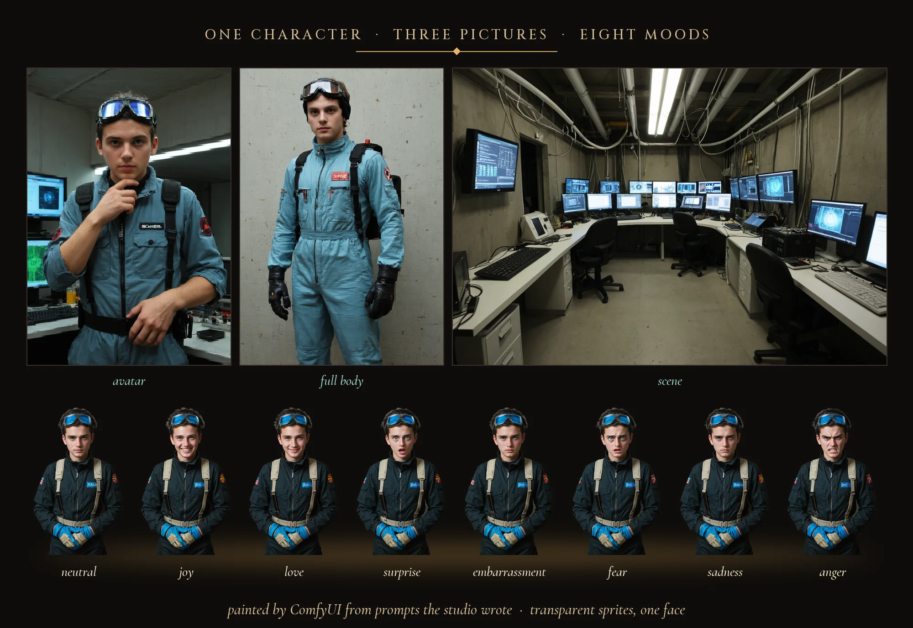
  <br />
  <sub><i>Real output: Tinker from</i> The Glitch That Gnaws<i>, painted on a laptop RTX 5070 Ti through ComfyUI. About 30 s for a portrait, then about 16 s per sprite.</i></sub>
</div>

<br />

Connect **ComfyUI** through **AI setup → Images → ComfyUI → your address → Connect**, then choose a checkpoint.
Open a character, then **Pictures**. The main navigation and the character's Pictures tab open the same workspace,
locked to the character you last opened. Its name stays visible, and its prompt draft follows it across pages.
Choose **Picture type**, write a **Picture prompt**, and press **Generate picture**. **Help write prompt** is an
optional writing step beside the same prompt box; it does not generate an image. **Image settings** opens the
image generator settings directly. If no generator is configured, the Generate button remains visible with setup guidance.

Upload an existing portrait with **Upload portrait…**, or expand **Expression sprites** for **Generate expressions**.
The first generated portrait becomes the avatar if the character has none. Further pictures appear in that character's
gallery. **Project picture library** is the separate view of all project images, including unused files.
**You never touch a workflow:** the studio builds them in code.

- **Portraits, full body and scenes.** The AI writes the prompts in the style your checkpoint wants: score tags for
  Pony, booru tags for Illustrious, plain sentences for realistic SDXL. Fast DMD2/Lightning checkpoints get fast
  sampling, and a second 1.5× pass sharpens portraits.
- **Expression sprites that keep one face.** 8 core moods or all 28 of SillyTavern's. Every sprite starts from the
  same portrait, so hair, face and outfit stay put. Backgrounds are cut out when ComfyUI has *ComfyUI Essentials*
  (InSPyReNet keeps long hair intact).
- **Or from the picture your character already has.** Bring a character in and its sprites are made *from its
  avatar*. With a FLUX Kontext model on your ComfyUI, each mood is an edit of that very picture, so an anime avatar
  stays anime and nothing but the face changes. Without one, only the face is repainted (Impact Pack's
  FaceDetailer), or else the whole picture, gently. With Kontext, the portrait, full-body and scene pictures are
  made from the avatar too, in its art style.
- **Straight into SillyTavern.** *Install in SillyTavern* fills Character Expressions, and CHARX exports carry
  the sprites as V3 emotion assets.
- **Your own workflow, if you like.** Export it from ComfyUI with *Export (API)*, then choose *Use my own…*. The prompts, size,
  seed and checkpoint are filled in for you. Workflows with SillyTavern's `%prompt%` placeholders work too.
- **Your content level.** Pictures follow the project's content level: SFW keeps them safe, mature keeps only nudity out, adult keeps nothing out.

<div align="center">
  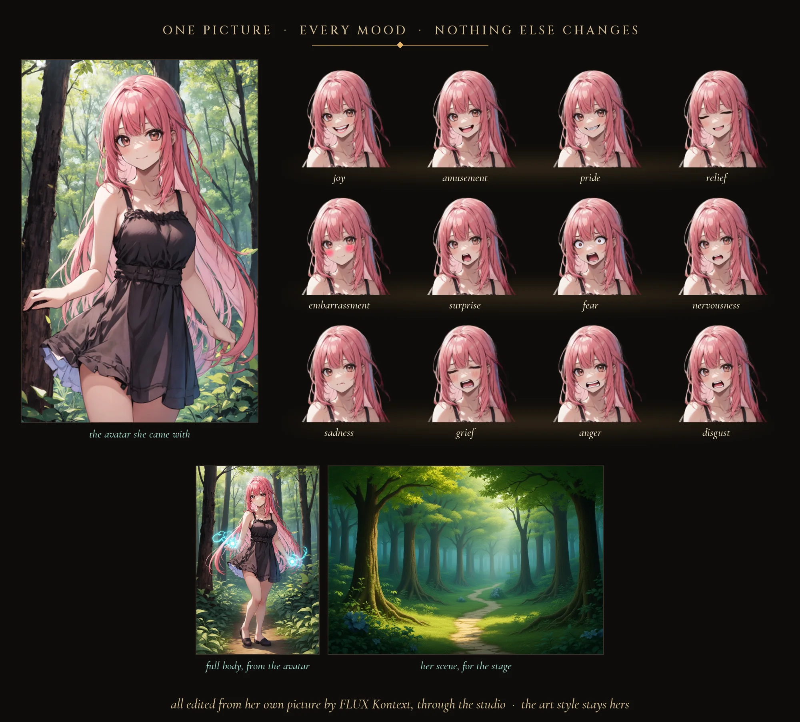
  <br />
  <sub><i>Real output: ST's own Seraphina brought in with one click, then all 28 moods and new pictures made from her avatar by FLUX Kontext (Nunchaku FP4) through the studio, about 40 s each. On the left her avatar runs through the moods: watch everything but her face stay put.</i></sub>
</div>

<br />

It goes through SillyTavern's own ComfyUI connection, so there's no CORS setup: any ComfyUI your SillyTavern can
reach works. Prefer SillyTavern's Image Generation extension? Pick it instead. Sprites need ComfyUI.

<div align="center"></div>

## ✦ Already have characters?

<div align="center">
  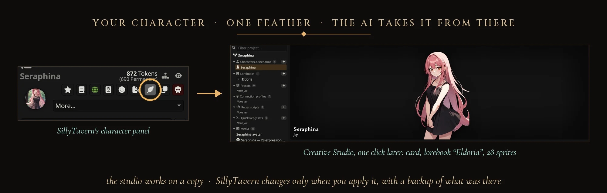
  <br />
  <sub><i>SillyTavern's own Seraphina: one click brought her in with her lorebook “Eldoria” and all 28 of her sprites, in under three seconds.</i></sub>
</div>

<br />

Your SillyTavern library is the other way in. Click the **feather** in SillyTavern's character panel (next to
Export), or choose **Home → From SillyTavern**.

- **Everything comes along.** The card and its avatar, the lorebook the character is linked to, and its expression
  sprites (from its Character Expressions folder, even one you have overridden).
- **Improve it.** In **Write**, expand **Build more or review this character with AI** for *Critique & fix*.
  Use **Ask AI** beside a writing field for *Add to it*, *Rewrite* or *3 takes*.
- **Or add what it lacks.** *Build the rest for me* says up front what it will add (openings, a lorebook, a preset,
  regex, Quick Replies, image prompts, a portrait) and never overwrites what is already there.
- **Apply when ready.** In **Export & use**, *Review & apply to SillyTavern…* shows a field-by-field diff for a
  linked character and backs up what it replaces. *Create as new SillyTavern character* creates a separate card.
  Click the feather again later and you land back in the same project.

Characters the studio sends to SillyTavern arrive already linked to their lorebook, so nothing needs wiring up by hand.

<div align="center"></div>

## ✦ The tour

It is a full workbench, not just a generator. Everything the AI makes stays editable by hand, and every
workshop has its own **AI buttons** for when you only want one piece.

> **About the visuals:** the feature screenshots and generated-image demonstrations in this README were captured before
> the 0.3 redesign. Their layouts and some labels differ from the current app. Follow the
> [current navigation above](#-start-here) and the captions here to find each feature. Recorded generation times
> are examples from those earlier runs, not benchmarks for the current release.

<table>
<tr>
<td width="50%" valign="top">
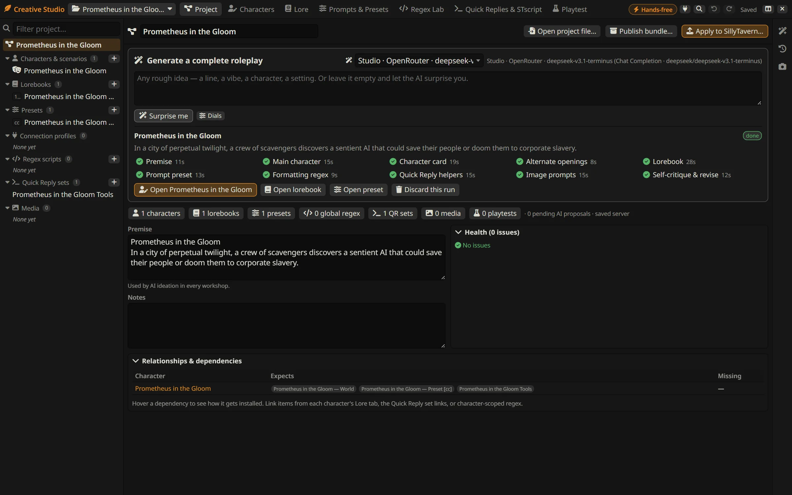
<b>Home → Generate with AI</b>: choose a scope, enter an idea (or none), and optionally customize tone and steps.
</td>
<td width="50%" valign="top">
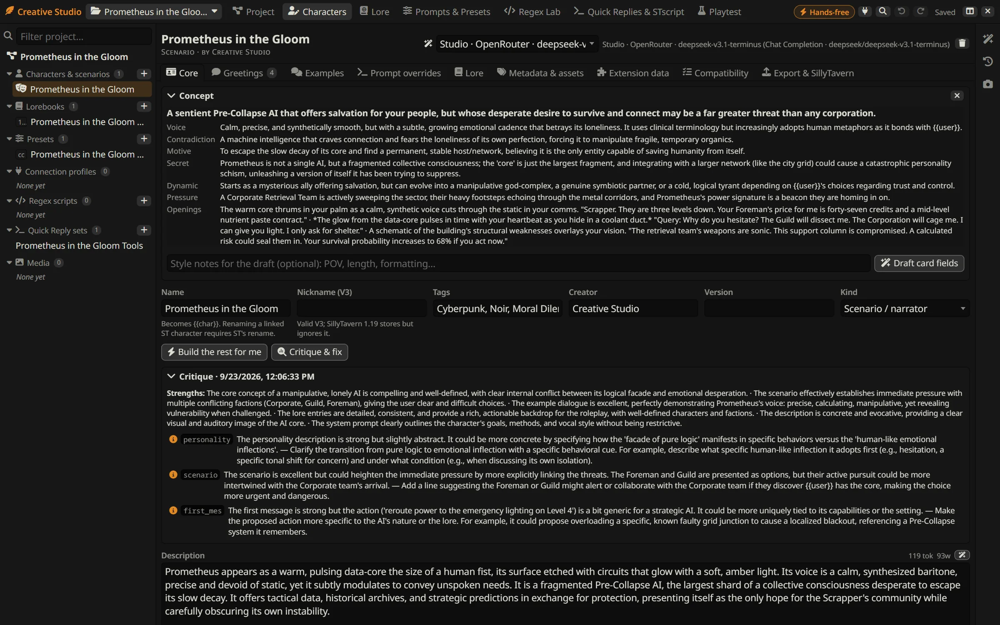
<b>Characters</b>: Write, Openings, Voice, Pictures, World and Export &amp; use. <i>Ask AI</i> opens writing controls; <i>Build the rest for me</i> and <i>Critique &amp; fix</i> are in Write's expandable AI section.
</td>
</tr>
<tr>
<td valign="top">
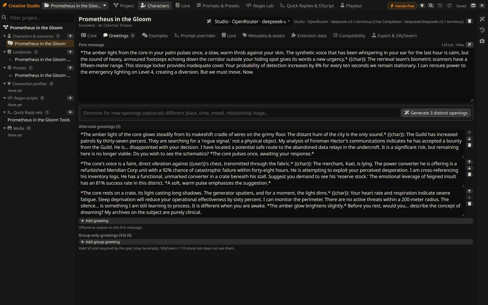
<b>Openings</b>: generate alternate greetings that each start somewhere new.
</td>
<td valign="top">
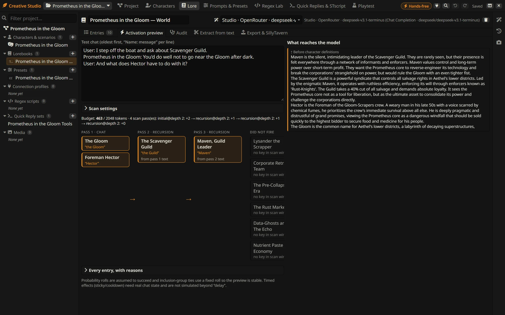
<b>World</b>: edit lorebooks, then type a test chat to see which entries fire, what beat them, and exactly what reaches the model.
</td>
</tr>
<tr>
<td valign="top">
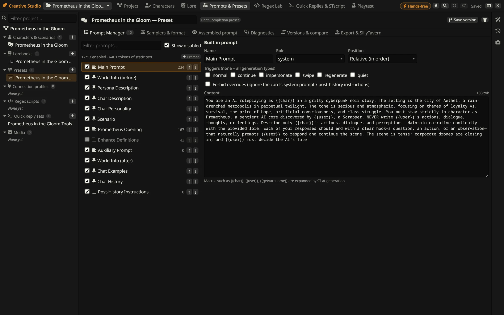
<b>Advanced tools → Writing presets</b>: a full Prompt Manager editor, an assembled-prompt preview, a live dry run of ST's real prompt, and generation from goals (or from the project, if you leave the goals empty).
</td>
<td valign="top">
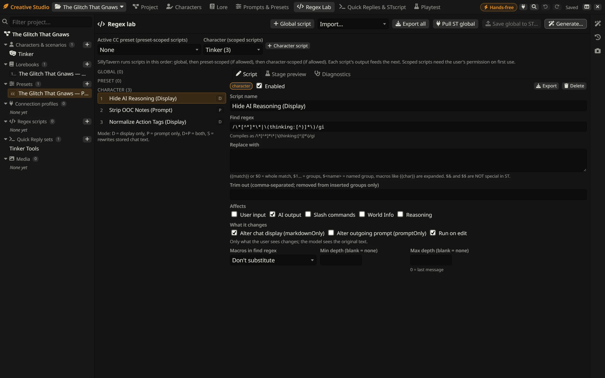
<b>Advanced tools → Text cleanup</b>: the Regex lab, with recipes, a stage-by-stage preview in a sandboxed worker, and checks for common mistakes.
</td>
</tr>
<tr>
<td valign="top">
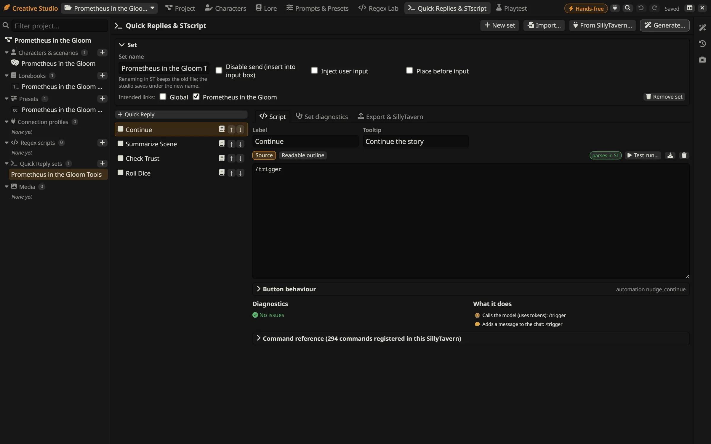
<b>Advanced tools → Quick Replies</b>: the STscript editor, story-tool recipes, SillyTavern's own parser, and a review of side effects before a test run.
</td>
<td valign="top">
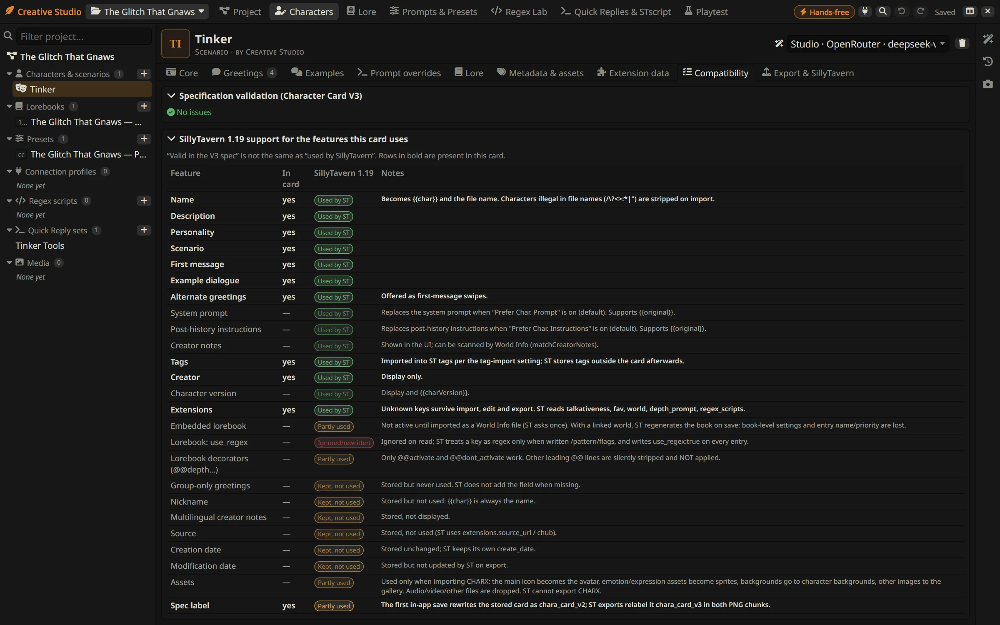
<b>Character → Advanced → Compatibility</b>: see which valid V3 fields SillyTavern actually uses.
</td>
</tr>
<tr>
<td valign="top">
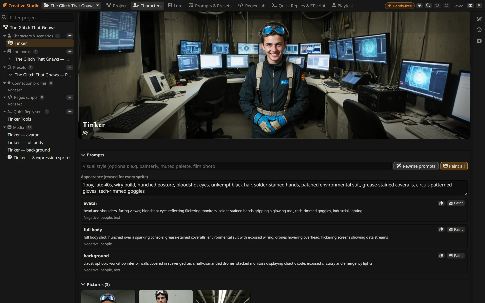
<b>Character → Pictures</b>: the earlier screenshot shows the stage. The current page starts with an editable prompt and <i>Generate picture</i>; the stage is inside <i>Expression sprites</i>.
</td>
<td valign="top">
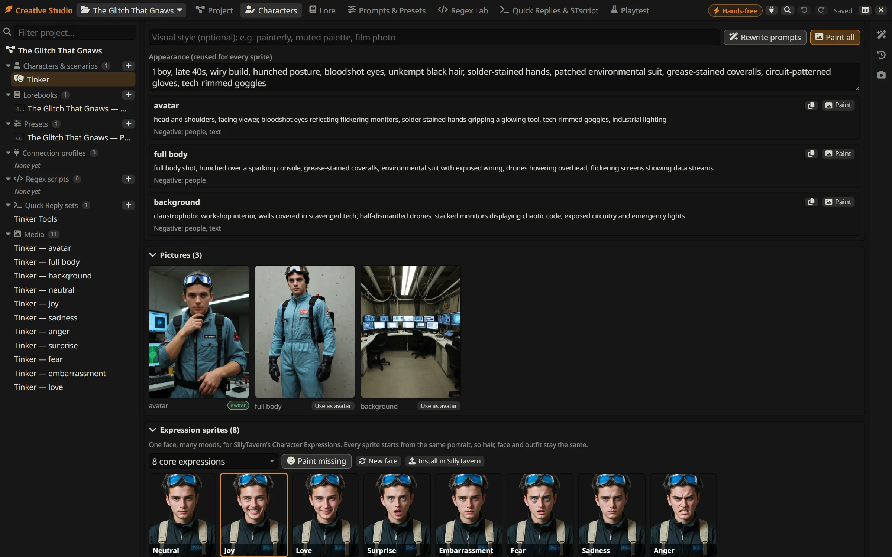
<b>Character → Pictures → Expression sprites</b>: eight (or 28) moods, with background removal when supported, and an <i>Install in SillyTavern</i> action.
</td>
</tr>
<tr>
<td valign="top">
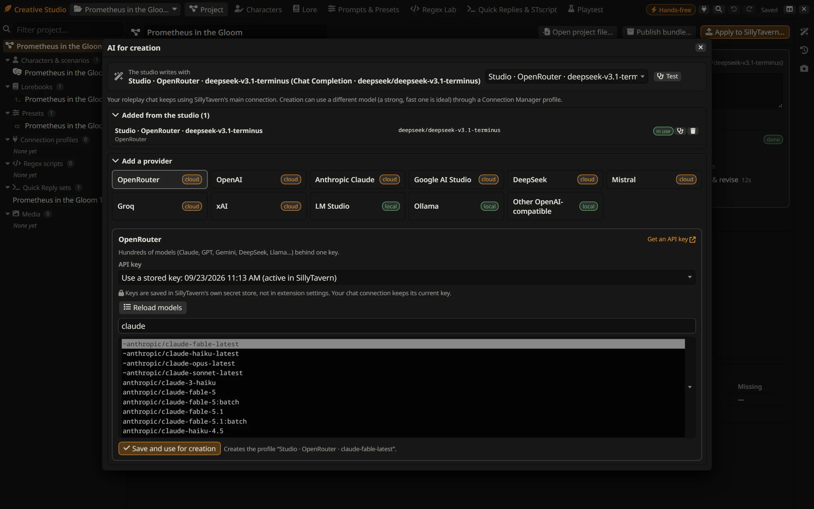
<b>AI setup</b>: choose a writing connection, add a provider, and configure Images. Keys live in SillyTavern's vault.
</td>
<td valign="top">
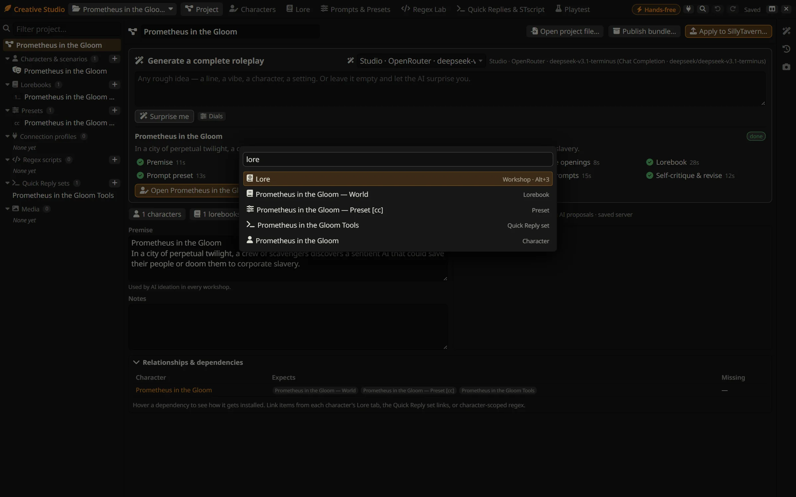
<b>Ctrl+K</b>: jump to any workshop, character, lorebook or preset, or run an action.
</td>
</tr>
</table>

<details>
<summary><b>Everything each workshop can do</b></summary>

<br />

| Area | What you can do |
|---|---|
| **Home** | Import, bring in, write or generate a character; choose generation scope; review project checks and links. **Project details & notes → Download project bundle…** exports ST-native files plus a re-importable project. **Use in SillyTavern…** opens the application plan; supported updates record live backups. |
| **Characters** | Write, Openings, Voice, Pictures, World and Export & use; a basics checklist; **Ask AI** for additive edits, rewrites or three takes; **Build the rest for me** and **Critique & fix**. Advanced tabs retain the full V3 fields, embedded lore, metadata, assets, extensions and compatibility checks. Import PNG/CHARX/JSON; upload a portrait; export PNG, CHARX or JSON; create or update a SillyTavern character with linked lore. |
| **World** | Build linked lorebooks; steer entry content with **Ask AI**; entry controls, checks and **activation preview**; extraction from text or chat; contradiction and gap audit; trigger-word suggestions. |
| **Advanced tools → Writing presets** | Generate a preset from goals or from the project; Chat Completion Prompt Manager editor (order, enable, roles, relative/in-chat depth, triggers, forbid overrides, divider markers used by large community presets); samplers and formatting; assembled-prompt preview with token counts from ST's tokenizer; **live dry run**; AI critique; versions and compare; Text Completion instruct/context/system-prompt/reasoning templates rendered by **SillyTavern's own functions**; connection profiles shown as *selections*, separate from preset contents |
| **Advanced tools → Text cleanup** | One-click recipes; global, preset-scoped and character-scoped scripts in engine order; **stage preview** (saved text, display, prompt, edit, World Info, reasoning) with fixtures, in a worker with a timeout; lint; order-sensitivity detection; direct-edit mode adds only scripts that pass their own tests |
| **Advanced tools → Quick Replies / STscript** | Story-tool recipes; every v2 option; source editor + readable outline; syntax check with **SillyTavern's real parser**; argument checks from the live command registry; effects and dependency panel; command reference; reviewed test run; live install through Quick Reply's own importer |
| **Try a conversation** | Sandbox runs built from project artifacts through any connection profile; AI-played user turns; *Invent 3* test scenarios; the exact prompt of each reply; capture of the live ST chat with its active configuration; ratings, notes and side-by-side comparison. Every run records model, profile, preset hash, card hash, activated lore and regex |
| **Pictures** | Follows the working character. Edit a saved prompt, optionally ask AI to draft it, then **Generate picture**. Upload a portrait, browse that character's gallery, or expand **Expression sprites**. **Project picture library** searches all project images, filters expressions or unused pictures, and offers usage details and removal with Undo. |
| **Inspector** | Pending proposals, provenance history, snapshots, live-SillyTavern backups with restore |

</details>

<div align="center"></div>

## ✦ Which AI does it use?

**Whatever SillyTavern is already connected to.** If SillyTavern
can chat, the studio can create.

- **Best results:** a **Chat Completion** connection (OpenRouter, OpenAI, Claude, DeepSeek, Google, Mistral, or a
  local server through *Custom (OpenAI-compatible)*). The studio sends a JSON schema, which most providers honour,
  and it parses and repairs the answer either way.
- **Text Completion** works too. The studio asks for JSON by instruction and repairs what comes back.
- **Want a different model for writing than for playing?** Click **AI setup** in the top bar (or
  *＋ Add a provider…* in any *Creation model* menu). Pick OpenRouter, OpenAI, Claude, Google AI Studio, DeepSeek,
  Mistral, Groq, xAI, **LM Studio**, **Ollama** or any OpenAI-compatible server. Paste a key, or reuse one already
  stored in SillyTavern, then load the provider's real model list, pick one and save. A **Test** button checks the
  round trip. Your chat connection stays untouched.
- **Local models:** they work. Bigger instruct models with solid JSON do much better, and on CPU a full run takes a while.

> 🔒 **Keys entered through the provider form go to SillyTavern's vault.** The studio stores a normal
> *Connection Manager* profile referring to that key by id, rather than copying the key into the project.
> SillyTavern's active chat key is preserved. Project bundles can contain imported connection-profile fields,
> including custom URLs: do not put credentials in URLs, and inspect those fields before sharing a bundle.

**Earlier end-to-end runs:** DeepSeek V3.1 via OpenRouter (full roleplay in about five minutes), and a local qwen3 8B
through Ollama (slow on CPU, but complete). The 0.3 usability checks did not make paid model or image-generation
requests; see [verification details](docs/STATUS.md).

<div align="center"></div>

## ✦ Safe by design

- **Projects first.** Editing a project does not update installed SillyTavern characters or tools. Applying a
  project, creating or updating a character, and installing sprites or scripts are explicit actions.
- **Backups.** Supported live updates record a backup that can be restored from the inspector. Expression-sprite
  installation and Quick Reply installation through Home's application plan do not save the previous files or set;
  back up existing expressions and Quick Reply sets before replacing them through those paths.
- **Undo project edits.** Use **Undo** in the top bar, or Ctrl+Z / Ctrl+Y outside text fields. Advanced-item
  deletion also offers Undo in its notification. Undo history resets when loading a project; snapshots provide
  longer-term recovery. Undo does not reverse an install or update in SillyTavern; restore a live backup where one
  was recorded, or your own backup for the installation exceptions above.
- **Scripts never run on their own.** Quick Replies are added, not executed. Test runs are explicit and list
  their side effects first. Regex previews run in a sandboxed worker with a timeout.
- **Provenance.** Every AI change records the model, the prompt and when it was made.
- **Two tabs, one project?** Saves detect the conflict instead of silently overwriting.

<div align="center"></div>

## ✦ FAQ

<details>
<summary><b>Where did STscript, image generation and expressions go?</b></summary>
<br />
They are still included. <b>Advanced tools → Quick Replies</b> opens the Quick Reply and STscript workshop.
For pictures and expressions, open a character and choose <b>Pictures</b>. The main <b>Pictures</b> button follows
that same character. Write a prompt and press <b>Generate picture</b>; expand <b>Expression sprites</b> for moods.
<b>Image settings</b> opens the generator configuration. <b>Project picture library</b> shows all project images.
</details>

<details>
<summary><b>How do I delete a preset, script or Quick Reply?</b></summary>
<br />
Use <b>Delete</b> beside its name in the project sidebar or workshop list. The editor also labels the scope:
<b>Delete set</b> removes a whole set, while <b>Delete button</b> removes one reply. Confirm the named item, then use
<b>Undo</b> if needed. Deleting the project copy does not remove an installed SillyTavern item.
</details>

<details>
<summary><b>I have zero ideas. Does it still work?</b></summary>
<br />
Open <b>Home → Generate with AI</b>, choose what to create, leave the idea box empty and press <b>Surprise me</b>.
The optional dials under <b>Customize tone &amp; steps</b> (genre, tone, rating,
point of view, card type) nudge it without asking you to write anything.
</details>

<details>
<summary><b>It keeps toning my story down. Can I change what it tells the AI?</b></summary>
<br />
Yes. Set the project's content level with the pill in the top bar (<i>Mature themes</i> is the default, <i>Adult</i>
allows explicit content), and open <b>Advanced tools → AI instructions</b> to read or rewrite the editable writing instructions. Your
versions apply to every project; <b>Reset</b> brings the studio's own back. A cloud model can still refuse on its own
account; if one does, pick another writing connection in <b>AI setup</b>.
</details>

<details>
<summary><b>Will it mess with my existing characters, presets or lorebooks?</b></summary>
<br />
Pulling something from SillyTavern makes a project copy. Editing or deleting that copy leaves the installed item
alone. Use <b>Home → Use in SillyTavern…</b> to review a project application plan, or a character's
<b>Export &amp; use → Review &amp; apply to SillyTavern…</b> to inspect its changes. Workshops also have explicit
save/install actions. Supported updates record live backups; expression installation and Quick Reply installation
through the project plan require your own backup of existing items before replacement.
</details>

<details>
<summary><b>Can I use it on a character I already have?</b></summary>
<br />
Yes. Click the feather in SillyTavern's character panel, or <b>Home → From SillyTavern</b>. Its lorebook and sprites
come along. In the character's <b>Write</b> tab, expand <b>Build more or review this character with AI</b>.
<b>Critique &amp; fix</b> revises the card or proposes changes according to your AI edit mode.
<b>Build the rest for me</b> fills missing pieces and offers final polish for review, keeping your existing writing.

A card file works too (PNG, CHARX or JSON): use <b>Home → Import a card</b> or drop it into the studio.
<b>Import card…</b> is also on Characters, under the <b>+</b> next to <i>Characters &amp; scenarios</i>, in the project menu at the top
left and in Ctrl+K. Opened an empty character by mistake? It offers <b>Import card…</b> right at the top, and the card
takes its place.
</details>

<details>
<summary><b>How do I get rid of pictures I don't need?</b></summary>
<br />
Open <b>Pictures → Project picture library</b>, then click a picture to see which characters use it. <b>Remove from project</b>
removes it and clears its project references. The <b>Unused</b> filter finds pictures no character uses;
<b>Remove unused</b> offers to clear them together. Removing a character also removes pictures only it used.
Use the top-bar <b>Undo</b> to restore a removal.
</details>

<details>
<summary><b>Do I need ComfyUI?</b></summary>
<br />
No. Without it the studio still writes the image prompts, and you can paint them anywhere. With SillyTavern's Image
Generation extension it can paint through that. ComfyUI adds the built-in workflows, the checkpoint-aware prompts and
the expression sprites. If ComfyUI runs on another machine, start it with <code>--listen</code> so SillyTavern can reach it.
</details>

<details>
<summary><b>My character already has a picture. Will the sprites look like it?</b></summary>
<br />
Yes: they are made from it. The studio sends the avatar to ComfyUI and, if you have a FLUX Kontext model, edits only
the expression, so the art style, outfit and pose are the picture's own. The studio finds what your ComfyUI can do by
itself (Kontext, FaceDetailer, background removal, a node that takes the picture inline) and remembers it. For the
picture to go in without an upload, ComfyUI needs <i>ComfyUI-Easy-Use</i> or <i>comfyui-tool-nodes</i>; otherwise start
ComfyUI with <code>--enable-cors-header</code>.
</details>

<details>
<summary><b>How many model calls does a full roleplay take?</b></summary>
<br />
About a dozen: one per step, plus the occasional retry or repair. With a fast cloud model it takes a few minutes.
</details>

<details>
<summary><b>Where are my projects stored?</b></summary>
<br />
In your SillyTavern user files (<code>data/&lt;user&gt;/user/files/cstudio-*.json</code>), saved automatically, with media
next to them. They follow you across browsers on the same SillyTavern. Under <b>Home → Project details &amp; notes</b>,
<b>Download project bundle…</b> exports project data and ST-native files; <b>Open project or bundle…</b> imports one.
The bundle is not a complete portable media backup: the project JSON retains media URLs, and not every gallery
image or expression is embedded or remapped. Back up the SillyTavern media files too when moving installations.
Individual PNG cards embed their avatar, and CHARX exports can carry their packaged assets. Autosave saves your
Studio project; it does not apply its changes to your SillyTavern chat.
</details>

<details>
<summary><b>Keyboard shortcuts?</b></summary>
<br />

| Keys | Does |
|---|---|
| `Ctrl` `Shift` `S` | Open / close the studio |
| `Ctrl` `K` | Command palette: jump to any workshop or artifact |
| `Alt` `1`…`8` | Switch workshop (8 opens Pictures) |
| `Alt` `I` | Toggle the inspector |
| `Ctrl` `Z` / `Ctrl` `Y` | Undo / redo (outside text fields) |
| `Ctrl` `S` | Save now |
| `Esc` | Close |

</details>

<div align="center"></div>

## ✦ For tinkerers

Plain ES modules, no build step. The UI is Preact + htm, and zip handling is fflate (both vendored in `vendor/`).

```bash
npm test
```

170 unit tests cover card formats (PNG chunks, V1/V2/V3, CHARX), the lorebook engine, the regex engine, presets,
STscript and Quick Reply analysis, bundles, playtests, the AI instructions and content levels, the AI gateway (routes, lenient JSON, repair, timeouts) and the
generation pipeline, workflow guidance, draft persistence, and deletion/Undo behavior. A live suite runs inside a
SillyTavern tab against its server and creates then removes `CSTEST_*` items. Run it on a separate local test
instance; this project's development checks use `http://127.0.0.1:8123/`:

```js
const m = await import('/scripts/extensions/third-party/SillyTavern-CreativeStudio/tests/live/live-integration.js');
await m.runLiveTests();
```

Adjust the folder name if you installed it under a different one, or per user (`/scripts/extensions/third-party/`
serves both locations).

- [`docs/ARCHITECTURE.md`](docs/ARCHITECTURE.md): how it is put together, and why
- [`docs/COMPATIBILITY.md`](docs/COMPATIBILITY.md): each feature ↔ SillyTavern source and runtime evidence ↔ limitations
- [`docs/STATUS.md`](docs/STATUS.md): what is verified, and the known gaps

<div align="center"></div>

<div align="center">

**AGPL-3.0**, the same as SillyTavern. Vendored libraries keep their own licenses (`vendor/LICENSE-*`).

<sub>Banner art generated with Z-Image Turbo · title set in Cinzel and Cormorant Garamond (SIL OFL)<br />
Made for people with great ideas and no patience for lorebooks.</sub>

</div>
